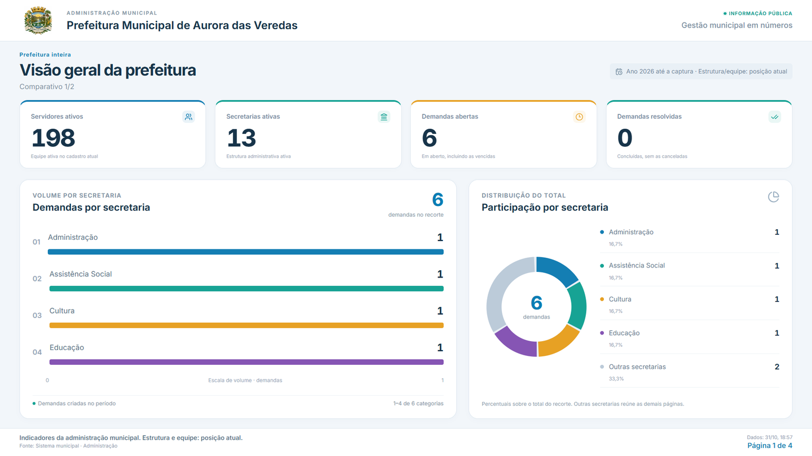

# Smart TV — revisão visual dos dashboards

## Direção visual

A revisão se aplica ao player público `/Smarttv` e à prévia do editor, que compartilham a mesma renderização. Referência: dashboards claros com cartões brancos, indicadores destacados, paleta azul/verde/âmbar/violeta/rosa, gráficos legíveis e legendas próximas dos dados.

- Cabeçalho institucional com logo, município e nome da programação.
- Indicadores com ícones, acentos de cor e explicação curta da medida.
- Comparação de secretarias com barras proporcionais, valor explícito, posição e escala.
- Rosca de participação com legenda, quantidade e percentual por secretaria.
- Evolução temporal com colunas, mês/ano, valores e meses sem entradas representados por zero.
- Resumo temporal com total dos meses exibidos, maior volume e meses com movimentação.
- Composições mistas mantêm imagem institucional ao lado dos indicadores e do gráfico.
- Paginação adaptativa para TV e celular, preservando as categorias e a escala global.

## Significado dos dados

1. O total no gráfico representa o recorte completo, mesmo quando as categorias precisam de mais de uma página.
2. Na rosca, **Outras secretarias** corresponde exatamente à diferença entre o total e a soma das categorias da página atual. Ela aparece apenas quando há essa diferença.
3. A legenda e as barras usam a mesma cor para a mesma categoria, inclusive nas páginas seguintes.
4. Meses consideram `America/Sao_Paulo`. Uma entrada em `01/10 00:00 UTC`, por exemplo, pertence a setembro no calendário municipal.
5. Meses sem entradas dentro do intervalo selecionado aparecem com zero; meses futuros não são acrescentados.
6. A data de criação explica o gráfico de entradas; quantidade de entradas não é taxa de resolução.
7. Estrutura e equipe mostram a posição atual. Em páginas só com esses dados, o período é apresentado como **Posição atual do cadastro**.
8. O título do recorte identifica Prefeitura inteira ou a secretaria selecionada. Indicadores de resolução e cancelamento permanecem separados.
9. Campos públicos continuam limitados à composição publicada. A revisão acrescenta contexto e totais aos mesmos agrupamentos autorizados.

## Arquivos

- `src/components/bi/DisplayPlayer.tsx` e `display-player.module.css`: composição, identidade e cartões.
- `src/components/bi/DisplayCharts.tsx` e `display-charts.module.css`: gráficos e legendas.
- `src/db/repositories/administration/bi-display.ts`: contexto do recorte e continuidade mensal.
- `src/lib/bi/display-service.ts`: revalidação do snapshot pelo período, independente do texto de apresentação.

## Verificação

- Testes de dados: `node --conditions=react-server --import tsx --test --test-concurrency=1 tests/bi-smarttv.test.ts tests/administration-bi.test.ts`.
- Conferência visual: `node scripts/bi-smarttv-visual-verify.mjs`, com a aplicação local na porta 3312; `BI_VISUAL_ORIGIN` permite selecionar outra origem.
- O ensaio visual verifica os dados reais e cenários controlados de volume, série mensal, composição mista e ausência de dados em HD, Full HD, 4K e celular. Os cenários sintéticos são interceptados somente no navegador do ensaio.
- Resultado e diretório das capturas: `docs/BI_SMARTTV_DESIGN_RESULTADO.json`.

A programação municipal e suas publicações são preservadas durante esse ensaio.

Resultado da revisão: **13 testes de dados aprovados**, ESLint dirigido aprovado e **28 cenários visuais aprovados**, run `4e7aa4f9-fd3c-40cc-9058-dbc1b666261a`. Em todos os cenários, o rodapé permaneceu visível e não houve overflow ou rolagem global. As imagens foram conferidas após a decodificação; nenhum erro JavaScript foi registrado. Os controles transitórios e o indicador de desenvolvimento são ocultados apenas nas capturas do ensaio visual.

Build de produção aprovado (`npm run build`): 15 partições TypeScript, compilação Next.js e 104 páginas estáticas. Smoke test com `next start`: rota pública HTTP 200, novo tema claro e gráficos de barras/rosca renderizados sem erros JavaScript.

### Prévia com a base municipal

Os valores desta prévia vêm da programação publicada no banco configurado. Os cenários de teste com volumes variados ficam identificados como sintéticos nas respectivas capturas.
